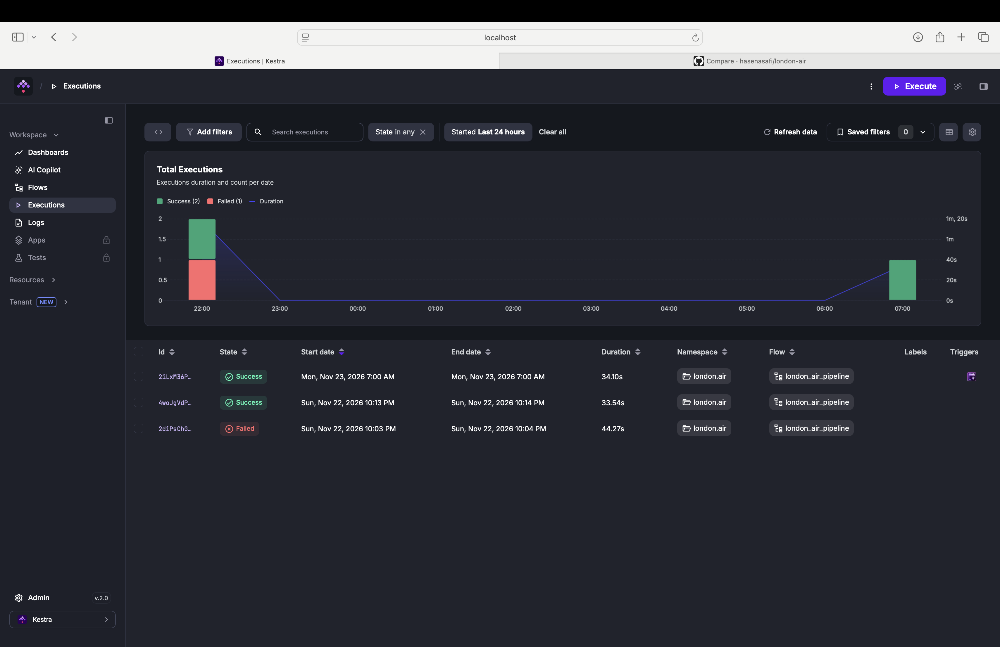

# Know the high-risk days: air quality for respiratory patients around St Helier

A pipeline that collects hourly air pollution readings for the area around St Helier Hospital, turns them into the government's Daily Air Quality Index (DAQI), and shows GP and pharmacy teams when to warn patients with asthma or COPD.

**Dashboard:** 

https://public.tableau.com/app/profile/hasena.safi/viz/air_quality_dashboard_17955296714830/Dashboard1?publish=yes

## What I built and who for

**Audience:** GP practices, community pharmacies and the respiratory team around St Helier Hospital (Sutton and Merton).

**The question it answers:** *Is today a day to warn respiratory patients, and when do high-risk days tend to happen?*

✏️ I'm a ward pharmacist at St Helier and have worked on the respiratory rotation. [One or two sentences in your own words: e.g. what you've seen with patients during pollution episodes, or what advice pharmacists actually give.]

The dashboard does two jobs:

- **Today's alert.** The latest DAQI for each nearby monitor, with the official advice for at-risk patients. It is not a forecast, but pollution episodes last several days, so a same-day alert is still worth acting on.
- **The history.** Every day since 22 September, so teams can see when episodes happen and warn high-risk patients *before* predictable dates such as Bonfire weekend.

### What the data showed

- **Sutton has no live public air monitoring.** Its last four monitors closed in June 2024. The nearest live sites are all in neighbouring Merton, so that is what this project uses.
- **Bonfire weekend was the worst period.** From 6 to 9 November, DAQI went Moderate → High → Very High (10, the top of the scale) at every site that measures fine particulates. The 24-hour PM2.5 mean peaked at more than double the warning level.
- **Fine particulates (PM2.5) caused every alert.** NO2 never reached the warning level.
- **The sites rise and fall together.** PM2.5 is largely regional, so one alert for the area is reasonable.
- **A site's alert is only as good as what it measures.** Morden Civic Centre, the closest site to St Helier, measures NO2 only, so it stayed green during the worst particulate days.

## The data

Data from the [London Air Quality Network](https://www.londonair.org.uk/), provided by the Environmental Research Group, Imperial College London, under the Open Government Licence v2. API: https://api.erg.ic.ac.uk/AirQuality/help

**How the endpoints connect:**

1. `Information/MonitoringSites/GroupName=London/Json` lists every site, its borough, type and opening/closing dates. I used it to find that Sutton's sites had closed.
2. `Data/Site/SiteCode=…` shows which pollutants each site actually measures.
3. `Data/SiteSpecies/SiteCode=…/SpeciesCode=…/StartDate=…/EndDate=…/Json` returns hourly readings for one site and one pollutant. This is the main source.

**What I collect:**

| Site | Code | Measures |
|---|---|---|
| Merton Road | ME2 | NO2, PM2.5, PM10 |
| Mitcham | MEA | NO2, PM2.5 |
| Morden Civic Centre | ME9 | NO2 |
| Plough Lane, Wimbledon | MEB | PM2.5, PM10 |

The first run backfilled 60 days. Every run since adds only the new hours, so the history has been collected over time by the pipeline itself.

**The benchmark:** the [Daily Air Quality Index](https://www.gov.uk/government/publications/health-effects-of-air-pollution/using-the-daily-air-quality-index-daqi) (Defra), scored 1–10 in four bands (Low, Moderate, High, Very High). Ozone and SO2 are part of the DAQI but are not measured at any nearby site.

## How it works

```
LAQN API ──► Bronze (raw, as received) ──► Silver (cleaned) ──► Gold (DAQI + alerts) ──► CSV ──► Tableau
             extract_load.py                dbt                  dbt                      export_gold.py
                          ▲
                  Kestra, every hour, in Docker
```

### Bronze: extract and load (`pipeline/extract_load.py`)

- `raw_readings` has a primary key on **site + pollutant + hour**, and inserts use `ON CONFLICT DO NOTHING`. A reading can never be stored twice.
- **Watermark:** each run finds the latest reading it already holds and only asks the API for data after that, so it never rebuilds the table.
- **Two-day overlap:** the API sometimes fills in hours late, so each run re-asks for the last two days. The primary key quietly ignores what is already there.
- `load_log` records every run: rows returned by the API and rows actually new. This is the proof that each run adds only new data.
- A one-second pause between calls keeps the load on a free API light.


### Silver and gold: dbt

| Layer | Model | What it holds |
|---|---|---|
| Silver | `silver_sites` | Sites with clear names, borough, open/closed |
| Silver | `silver_readings` | One clean row per site, pollutant and hour; negative instrument noise removed |
| Gold | `gold_hourly_index` | DAQI per site, pollutant and hour |
| Gold | `gold_daily_index` | DAQI per site, pollutant and day |
| Gold | `gold_daily_alert` | Worst pollutant per site per day, band and patient advice |
| Gold | `gold_current_alert` | The latest DAQI per site: "should we warn patients today?" |

The DAQI thresholds and advice live in two small seed files (`seeds/`). Each pollutant is averaged the official way: NO2 uses the hourly value; PM2.5 and PM10 use a 24-hour mean, which is only calculated when at least 18 of the 24 hours were measured.

**24 dbt tests** check, among other things, that every reading is unique and that every band is valid.

**Two database files:** `data/air_quality.duckdb` holds the bronze history and is committed, because it cannot be recreated. `data/warehouse.duckdb` holds silver and gold, and is left out of git because `dbt build` can rebuild it. dbt reads bronze **read-only**, so it can never change the raw data.

### Orchestration: Kestra in Docker

`run_pipeline.sh` runs the three steps in order and stops at the first error. Kestra runs it **every hour** inside my own Docker image (`Dockerfile`), which has the exact tool versions pre-installed. Runs retry twice on failure and never overlap.



### What the data model makes difficult

- **Missing sensors.** Plough Lane's PM2.5 sensor went quiet on 20 November. The current alert ignores readings older than 24 hours, so a dead sensor cannot show a stale "Low" as if it were current. Gaps stay visible on the charts rather than being filled in.
- **Different sites measure different pollutants.** A site's DAQI only reflects what it measures, which is why Morden looks safer than it is.
- **No row for days without data.** The gold tables only hold days with readings, so the dashboard shades empty days grey rather than the model listing them.
- **Time zone.** The API reports in GMT all year; the model keeps GMT and labels it.

## How to run it

Requires Python 3.9+ and, for scheduling, Docker Desktop.

```bash
python3 -m venv .venv
source .venv/bin/activate
pip install -r requirements.txt

# whole pipeline once: bronze → dbt (silver + gold, with tests) → CSV export
bash run_pipeline.sh

# or step by step
python pipeline/extract_load.py
dbt build
python pipeline/export_gold.py
python pipeline/show_results.py   # current alert, warning days, quiet sensors, run history
```

To schedule it hourly with Kestra:

```bash
docker build -t london-air-pipeline:1 .
bash start_kestra.sh            # then open http://localhost:8080
```

Change the project path in `flows/london_air_pipeline.yml` to where you cloned the repo. Sites and pollutants are set in `pipeline/config.py`, so adding another borough is one line.

## What I would do next

- **Run it in the cloud,** so it doesn't depend on my laptop being awake, and store the data in cloud storage instead of git.
- **One area-wide alert:** the worst reading across all sites each day, so a single site's missing pollutants can't make the area look safer.
- **A forecast,** using the DAQI forecast or weather data, so warnings can go out the day before.
- **Weather data** to test the cause of episodes: fireworks versus cold, still air.
- **Link to hospital data:** do respiratory A&E attendances or COPD admissions at St Helier rise a day or two after an episode?
- **A date spine in dbt,** so every site has a row for every day and missing days are explicit in the model.
- **A longer backfill** (a year or more) to show seasonal patterns and previous Bonfire Nights.

## Where AI helped

I used Claude as a coding partner throughout. It drafted the first versions of the extract-and-load script, the dbt models and tests, the Kestra flow and the Dockerfile, and helped me debug the Kestra failures. I chose the angle, the audience, the sites and the official DAQI benchmark; found that Sutton's monitors had closed; ran, tested and fixed everything on real data, and buildt the dashboard. 