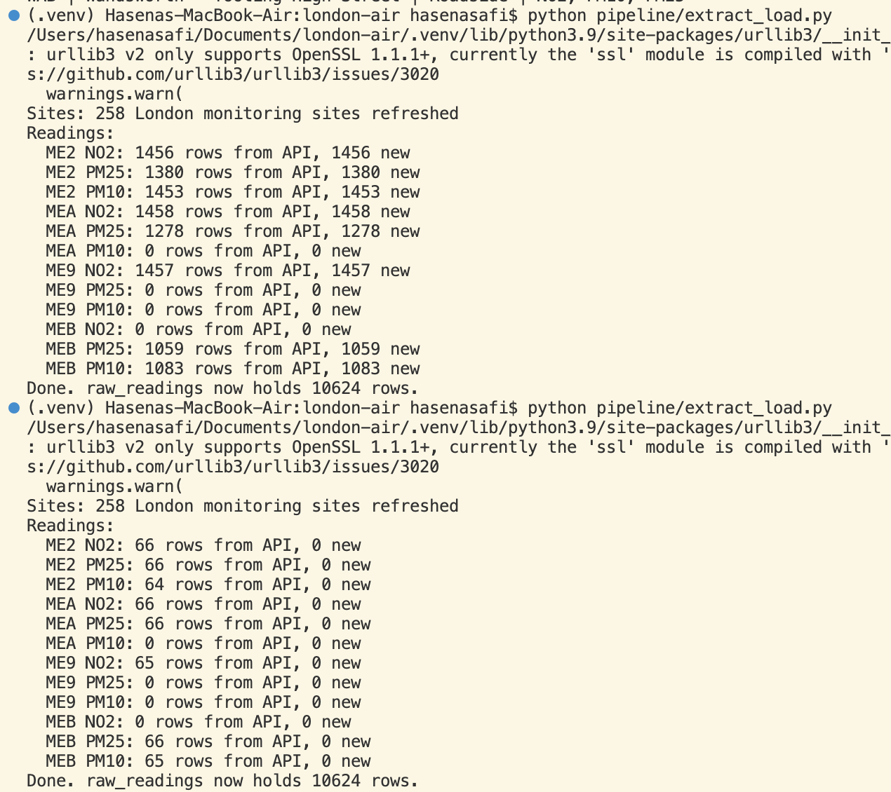

# Know the high-risk days: air quality for respiratory patients around St Helier

An end-to-end data pipeline that collects hourly air pollution readings for the area around St Helier Hospital (Sutton and Merton), turns them into the UK government's Daily Air Quality Index (DAQI), and shows GP and pharmacy teams when to warn patients with asthma or COPD.

Built in November 2026 with Python, DuckDB, dbt, Kestra, Docker and Tableau.

**Dashboard:** [view on Tableau Public](https://public.tableau.com/views/air_quality_dashboard_17955296714830/Dashboard1)

## What I built and who for

**Audience:** GP practices, community pharmacies and the respiratory team around St Helier Hospital.

**The question it answers:** *Is today a day to warn respiratory patients, and when do high-risk days tend to happen?*

I'm a hospital pharmacist at Epsom and St Helier and have worked on the respiratory rotation, so I chose an angle where I understand the audience and what advice they actually give.

The dashboard does two jobs:

- **Today's alert:** the latest DAQI for each nearby monitor, with the official advice for at-risk patients. It isn't a forecast, but pollution episodes usually last several days, so a raised alert today is an early warning for the days ahead.
- **The history:** every day since 22 September 2026, so teams can see when episodes happen and warn high-risk patients *before* predictable dates such as Bonfire weekend.

### What the data showed

- **Sutton has no live public air monitoring.** Its last four monitors closed in June 2024, so this project uses the nearest live sites, all in neighbouring Merton.
- **Bonfire weekend was the worst period.** From 6 to 9 November the DAQI went Moderate → High → Very High (10, the top of the scale) at every site that measures fine particulates. The 24-hour PM2.5 mean peaked at more than double the warning level.
- **Fine particulates (PM2.5) caused every alert.** NO2 never reached the warning level.
- **The sites rise and fall together.** PM2.5 is largely regional, so one alert for the area is reasonable.
- **A site's alert is only as good as what it measures.** Morden Civic Centre, the closest site to St Helier, measures NO2 only, so it stayed green during the worst particulate days.

## The data

Data from the [London Air Quality Network](https://www.londonair.org.uk/), provided by the Environmental Research Group, Imperial College London, under the Open Government Licence v2. API: https://api.erg.ic.ac.uk/AirQuality/help

**How the endpoints connect:**

1. `Information/MonitoringSites/GroupName=London/Json` lists every site, its borough, type and opening/closing dates. I used it to find that Sutton's sites had closed.
2. `Data/Site/SiteCode=…` shows which pollutants each site actually measures.
3. `Data/SiteSpecies/SiteCode=…/SpeciesCode=…/StartDate=…/EndDate=…/Json` returns hourly readings for one site and one pollutant. This is the main source.

| Site | Code | Measures |
|---|---|---|
| Merton Road | ME2 | NO2, PM2.5, PM10 |
| Mitcham | MEA | NO2, PM2.5 |
| Morden Civic Centre | ME9 | NO2 |
| Plough Lane, Wimbledon | MEB | PM2.5, PM10 |

The first run backfilled 60 days. Every run after that added only the new hours, so most of the history was collected over time by the pipeline itself.

## How it works

```
LAQN API ──► raw tables ──► staging ──► intermediate ──► marts ──► CSV ──► Tableau
             extract_load.py   └──────────── dbt ────────────┘    export_marts.py
                    ▲
          Kestra, every hour, in Docker
```

### 1. Extract and load (`pipeline/extract_load.py`)

- `raw_readings` has a primary key on **site + pollutant + hour**, and inserts use `ON CONFLICT DO NOTHING`, so a reading can never be stored twice.
- **Watermark:** each run finds the latest reading it already holds and only asks the API for data after that, so the table is never rebuilt.
- **Two-day overlap:** the API sometimes fills in hours late, so each run re-asks for the last two days and the primary key ignores what is already there.
- `load_log` records every run: rows returned by the API and rows actually new. This is the proof that each run adds only new data.
- A one-second pause between calls keeps the load on a free API light.



### 2. Transform with dbt (staging → intermediate → marts)

The dbt project follows dbt's recommended structure. Seeds feed the intermediate layer, and marts never read from other marts.

| Layer | Model | What it does |
|---|---|---|
| Staging | `stg_laqn__sites`, `stg_laqn__readings` | One model per raw table. Renaming and type-casting only. |
| Intermediate | `int_readings_enriched` | Joins site details onto each reading and removes negative instrument noise. |
| Intermediate | `int_daqi_levels` | Turns the two seed files (DAQI thresholds and advice) into one lookup. |
| Intermediate | `int_daqi_hourly` | DAQI per site, pollutant and hour. |
| Intermediate | `int_daqi_daily_by_pollutant` | DAQI per site, pollutant and day. |
| Mart | `fct_daqi_hourly` | Site × pollutant × hour. Feeds the PM2.5 trend charts. |
| Mart | `fct_daqi_daily` | Site × day, worst pollutant wins. Feeds the calendar and headline numbers. |
| Mart | `fct_daqi_current` | One row per site, right now. Feeds today's alert. |

There are three marts because the dashboard needs three different grains. Anything that is only a filter, sort or count happens in Tableau.

**Tests:** 39 dbt data tests (unique readings, valid bands, relationships between models), plus a **source freshness** check that warns if no new data has arrived for 6 hours.

**Two database files:** `data/air_quality.duckdb` holds the raw history and is committed, because it cannot be recreated. `data/warehouse.duckdb` holds the dbt models and is left out of git, because `dbt build` rebuilds it. dbt reads the raw file **read-only**, so it can never change the raw data.

### Method and assumptions

From official UK guidance ([gov.uk DAQI pages](https://www.gov.uk/government/publications/health-effects-of-air-pollution/pollutant-concentrations-for-the-daily-air-quality-index-daqi)):

- The band thresholds for each pollutant (index 1 to 10; Low, Moderate, High, Very High).
- The averaging rules: NO2 uses the hourly value; PM2.5 and PM10 use the daily mean for past days, or the latest 24-hour running mean for the current day.
- The overall score is the worst pollutant at that site.
- Moderate or worse is when people vulnerable to air pollution should take action.

My own choices:

- A PM daily mean is only scored if at least 18 of the 24 hours were measured (75%), so a mostly-missing day doesn't get a misleading score.
- For a daily NO2 score, I take the highest hour of the day.
- Averages are rounded to whole numbers before looking up the band, because the band edges are whole numbers.

Ozone and SO2 are part of the DAQI but are not measured at any nearby site.

### 3. Orchestrate with Kestra and Docker

`run_pipeline.sh` runs extract and load → `dbt build` → export, and stops at the first error. During the project, Kestra ran it **every hour** inside a custom Docker image (`Dockerfile`) with the exact tool versions pre-installed. Runs retried twice on failure and never overlapped.

Running it for real surfaced a problem testing didn't: about a quarter of overnight runs failed because the container reinstalled packages from the internet on every run and timed out when the laptop was asleep. Building the tools into the image, adding retries and stopping overlapping runs fixed it.


### 4. Dashboard (`dashboard/air_quality_dashboard.twbx`)

A [Tableau Public dashboard](https://public.tableau.com/views/air_quality_dashboard_17955296714830/Dashboard1) with live headline numbers (today's band, warning days, worst day), a map of today's alert, a daily DAQI calendar, PM2.5 trends against the warning level, and notes on what it means for practice and the limits of the data.

### What the data model makes difficult

- **Missing sensors.** Plough Lane's PM2.5 sensor went quiet on 20 November. The current alert ignores readings older than 24 hours, so a dead sensor can't show a stale "Low" as if it were current.
- **Different sites measure different pollutants.** A site's DAQI only reflects what it measures, which is why Morden looks safer than it is.
- **No row for days without data.** The marts only hold days with readings, so the dashboard shades empty days grey.
- **Time zone.** The API reports in GMT all year, and the model keeps and labels GMT.

## Repository layout

```
pipeline/      extract_load.py, config.py (sites and pollutants), export_marts.py
models/        dbt: staging/, intermediate/, marts/
seeds/         DAQI thresholds and advice (CSV)
kestra/        start_kestra.sh, config.yml, flows/london_air_pipeline.yml
dashboard/     Tableau workbook
exports/       CSVs the dashboard reads
data/          raw DuckDB history
exploration/   one-off scripts used to explore the API and find the sites
scripts/       show_results.py: current alert, warning days, quiet sensors, run history
docs/          screenshots
```

## How to run it

Requires Python 3.9+ and, for scheduling, Docker Desktop.

```bash
python3 -m venv .venv
source .venv/bin/activate
pip install -r requirements.txt

bash run_pipeline.sh               # extract → dbt build (with tests) → CSV export
dbt source freshness               # is new data still arriving?
python scripts/show_results.py     # current alert, warning days, quiet sensors, run history
```

To schedule it hourly with Kestra:

```bash
docker build -t london-air-pipeline:1 .
bash kestra/start_kestra.sh        # then open http://localhost:8080
```

Change the project path in `kestra/flows/london_air_pipeline.yml` to where you cloned the repo. Sites and pollutants are set in `pipeline/config.py`, so adding another borough is one line.

## What I would do next

- Run it in the cloud, so it doesn't depend on a laptop being awake, and store the data in cloud storage instead of git.
- One area-wide alert: the worst reading across all sites each day, so one site's missing pollutants can't make the area look safer.
- Add a forecast, so warnings can go out the day before.
- Add weather data to test the cause of episodes: fireworks versus cold, still air.
- Link to hospital data: do respiratory A&E attendances or COPD admissions rise a day or two after an episode?
- A date spine in dbt, so every site has a row for every day and missing days are explicit.
- A longer backfill (a year or more) to show seasonal patterns and previous Bonfire Nights.

## Where AI helped

I used Claude (Anthropic) as a coding partner throughout. It drafted first versions of the extract-and-load script, the dbt models and tests, the Kestra flow and the Dockerfile, and helped me debug and build the Tableau dashboard. I chose the angle and audience, the sites and the official DAQI benchmark; found that Sutton's monitors had closed; ran, tested and fixed everything on real data; restructured the dbt project after feedback from my mentor; and decided what the dashboard should say to clinicians.